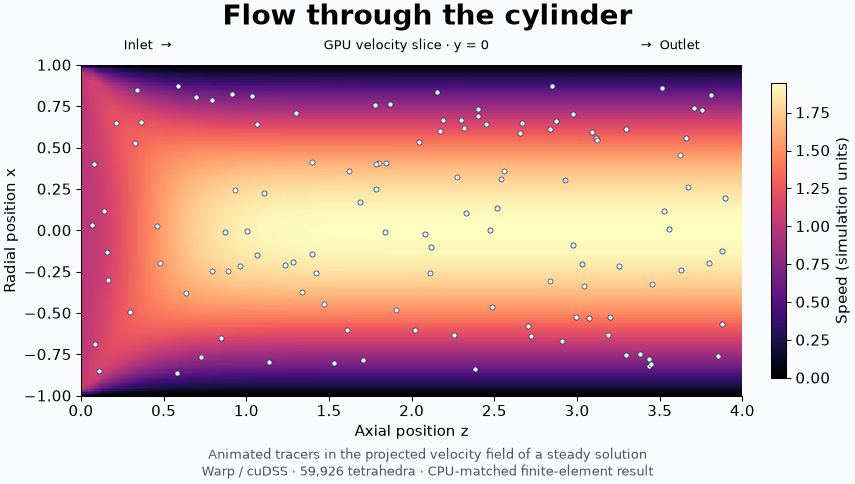

# Stokes flow: DOLFINx → Warp

**33.1× faster than CPU** for a validated 271,506-unknown Taylor–Hood Stokes solve on 59,926 tetrahedra. The latest implementation is **about 2× faster than the original GPU code** in fresh comparisons.

[3D view of the slice](results/visuals/flow-scene-3d.png) · [CPU/GPU velocity and pressure slices](results/visuals/flow-slices.png) · [Animation (MP4)](results/visuals/flow-tracers.mp4). Tracers move through the projected center-plane velocity field of the steady solution.

| Complete numerical pipeline | Median time |
| --- | ---: |
| DOLFINx + CPU MUMPS, 4 threads | 13.241 s |
| Original GPU implementation, fresh runs | 0.786–0.814 s |
| Warp 1.19 + symmetric-indefinite cuDSS, CUDA graph | 0.400 s |

The graph recomputes geometry, assembles float32 P2/P1 matrices, applies boundary conditions, refactors, and solves with device residual correction. Relative FEM errors against the float64 CPU reference are **1.8e-07 velocity** and **4.8e-07 pressure**; flux imbalance is 1.0e-09. Bent and constricted meshes, nonuniform inlet values and changed graph inputs also pass validation.

Measured on a shared RTX PRO 6000 Blackwell **24 GiB MIG partition**, with a four-core CPU quota and 16 GiB host RAM. Times cover repeated numerical work after fixed-topology setup; mesh preparation, compilation and symbolic analysis are separate. Matrices and factors use float32; geometric Jacobians and residual accumulation use float64 on device. The historical 7.7× result had different machine conditions; that change is not credited to the optimization.

[Reproduce](docs/reproduce.md) · [Performance audit](results/performance/README.md) · [Model and accuracy contract](docs/method.md) · [Issue history](https://github.com/alecjacobson/stokes-flow/issues?q=is%3Aissue)

Warp is pinned to the official **1.19.0rc1** build. FSAI + CG was evaluated on the SPD velocity block; cuDSS is the complete Stokes solver used above. The original 10-million-tetrahedron scale has not been benchmarked.
